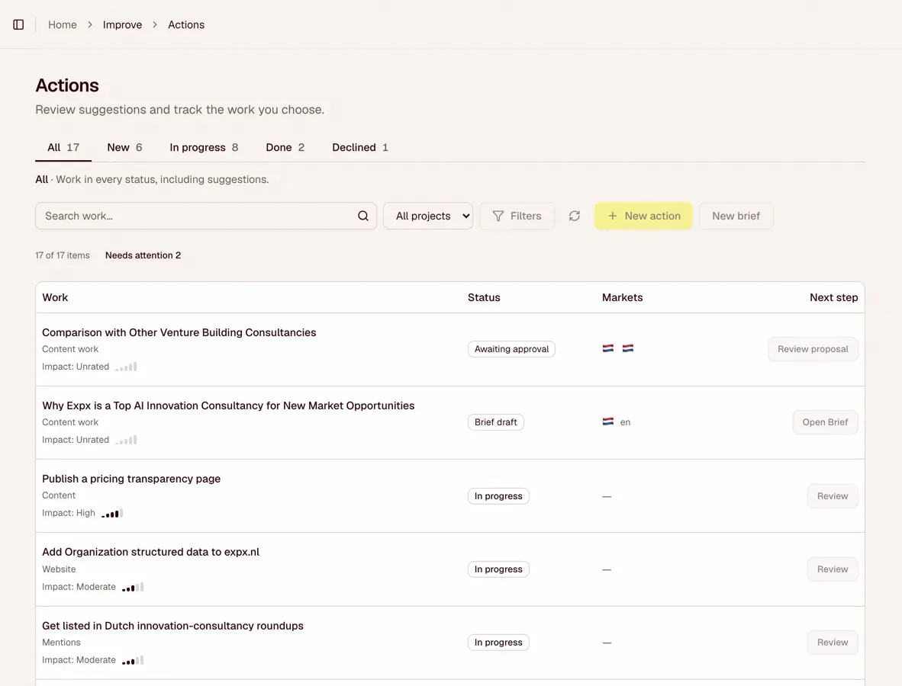

Every other screen in Surfaced tells you something. Actions is where those findings become work with an owner.

<Frame>
  
</Frame>

It is deliberately one queue rather than a to-do list per screen. A gap in the answers, a critical finding on your site and a page that needs rewriting are all things somebody has to do this week, and splitting them across three screens is how two of them get forgotten.

## What is in the queue

Items arrive from across the product and carry the source they came from: work on your content, a change to your website, something the answers are saying. Each one shows its evidence, an expected impact from very high down to very low, its markets, and a next step rather than a restatement of the problem.

| Tab | What it shows |
| --- | --- |
| All | Every item, in every state, including suggestions. |
| New | Nothing has happened yet. |
| In progress | Someone has picked it up, or it is being written. |
| Done | Finished. |
| Declined | Looked at and decided against. |
| Results | Did the work pay off? Surfaced's own verdict on each finished action. |

An item whose work stopped part-way shows **Didn't finish**, with a next step such as **Change** or **Write it again**. A separate **Needs attention** count flags those, plus items that have gone stale or whose underlying finding has changed.

Use **New action** to add your own item and **New brief** to go straight to writing. Search, **Filters**, **Sort** and **Group** work as on the other lists.

## The sidebar badge is personal

The number next to Actions in the sidebar counts the items **assigned to you**, not the total in the queue. Two people looking at the same workspace see different numbers, and someone with nothing assigned sees none at all.

This is on purpose. A badge showing the team's whole backlog is a number nobody acts on; a badge showing your own three is one you clear.

## Working the queue

Filter by state to separate triage from execution. The usual rhythm is to take the new items once a week, decline what does not fit, assign the rest, and leave in-progress work to the people holding it.

Record a decline rather than leaving the item new. The next person to open the queue then sees the decision instead of re-making it.

## How an action relates to the finding behind it

Closing an action records that you did the work. It does not verify the result. Whether the answers changed is what the following tracking runs tell you, and whether your site changed is what the next [audit](/insights/audit-report) tells you.

The **Results** tab does that follow-up for you. It tracks the share of answers that mention you week by week (switchable to share of voice), marks when each piece of work went live, and gives every finished action a verdict: **Measuring** (with the date measurement ends), **Worked**, or **Didn't work or no verdict**.

So expect a lag. Content published this week will not move [brand visibility](/metrics/brand-visibility) until the engines have re-read your site and a run has asked the questions again. Judge the work on the next few runs.

## Where items come from

Three cards at the top of the page group the work by where it came from, each with its count of new and in-progress items and a link to the screen behind it:

- **Content gaps**, from [Gap trends](/insights/gap-trends). Accepting a gap creates work, usually a brief.
- **Website audit**, from the [Audit report](/insights/audit-report). A content finding can become a brief directly; technical findings become site work.
- **Backlink opportunities**, from [Sources](/insights/sources). Third-party pages that AI answers cite for your questions but that do not mention you, found by reading the cited pages themselves. Getting mentioned there is the opportunity. (Surfaced does not use backlink databases.)

A published page that is not being cited, from [Content performance](/insights/content-performance), also lands here.

Each item keeps a link back to what produced it, so you can always get from the task to the evidence.
