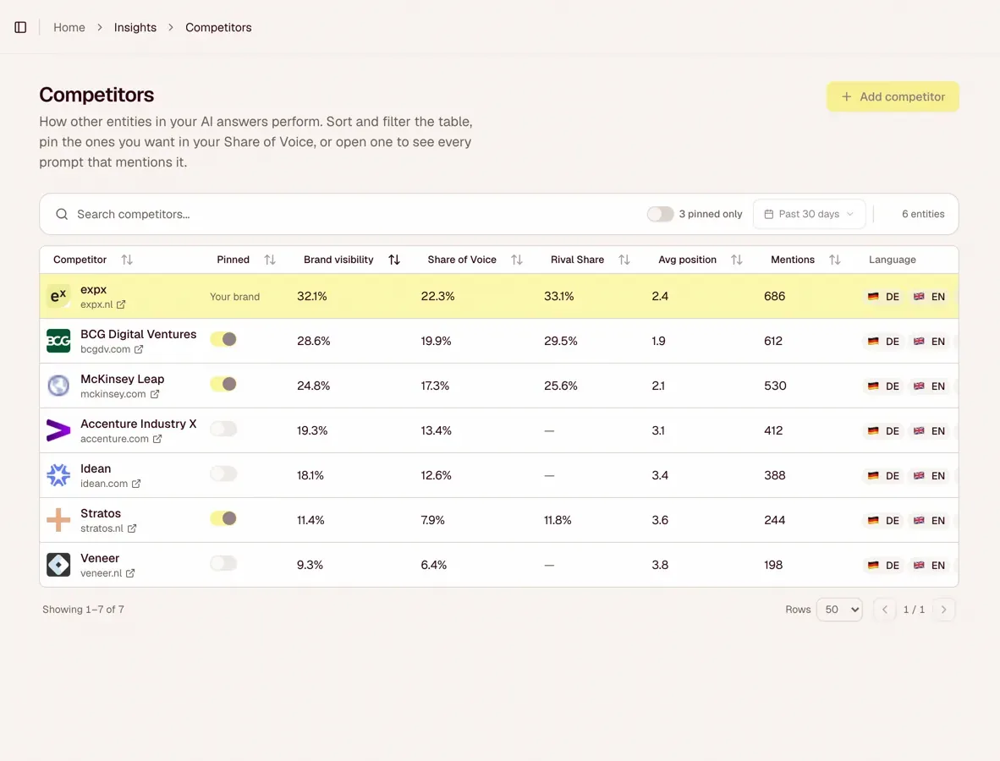

Competitors lists the brands that appear in your tracked answers, with the same metrics you are measured on. Pinning is how you tell Surfaced which of them are genuine rivals.

<Frame>
  
</Frame>

## What is on the page

One table. Your own brand is always a row, highlighted and labelled "Your brand", even in periods where it was never mentioned.

| Column | What it means |
| --- | --- |
| Competitor | The detected brand, with its domain. |
| Pinned | Marks the brands you care about, so you can filter to them, see them on Home and compare against them with rival share. It does not change your [share of voice](/metrics/share-of-voice). |
| Brand visibility | Its mentions as a share of all answers in the period. |
| Share of voice | Its mentions against every brand mentioned alongside it. |
| Rival share | The stricter version: measured against your pinned competitors only. Populated for pinned rows. |
| Average position | Its average rank where answers ranked options. |
| Mentions | Its total mentions in the period. |
| Language, Asked from, Mentioned by | Where and on which platforms it showed up. |

Clicking a row opens that brand: every prompt that mentions it, so you can see which questions you are losing to whom.

## Detected, added, pinned

Brands get into this table on their own: the analysis of each answer is asked which other companies it named, and those arrive as **unverified** detections.

**Add competitor** creates or confirms a brand by hand, in a preview-then-confirm step. It is uncapped, because adding only puts a name in the table.

**Pinning** is a way of marking the rivals you care about for easier viewing and filtering, and the only one of the three your plan caps. A pinned competitor gets a **rival share** figure, appears on the dashboard, and is what you have declared to be a real rival.

Pinning does **not** change [share of voice](/metrics/share-of-voice) on Analytics, which is measured against every detected brand regardless. It changes rival share, the comparison against your pinned set alone.

Adding, pinning and unpinning need the editor role or above; anyone can read the table.

## These are detections, not verified rivals

Everything in this table was found in your answers. Nothing has been checked for competing with you. A consultancy's table will hold publishers, research firms and tool vendors alongside real competitors; a retailer's will hold marketplaces.

Leave it there rather than cleaning it away. Knowing that a trade publication is named more often than any vendor is a finding in itself. It does mean the unpinned rows are raw input, and pinning is the editorial step.

## A dash is not a zero

`—` means the window measured nothing for that row. `0.0%` means it was measured and the answer was zero. Rival share is `—` on every unpinned row because the comparison does not apply, not because the brand scored nothing.

## Empty states

- **No competitors detected yet.** They appear as tracking runs complete.
- **No pinned competitors yet.** Shown when the pinned-only switch (the toggle that hides every unpinned row) is on and nothing is pinned.
- **Your brand alone in the table.** An extra line explains it, because a single all-dashes row with no explanation reads like a bug.
