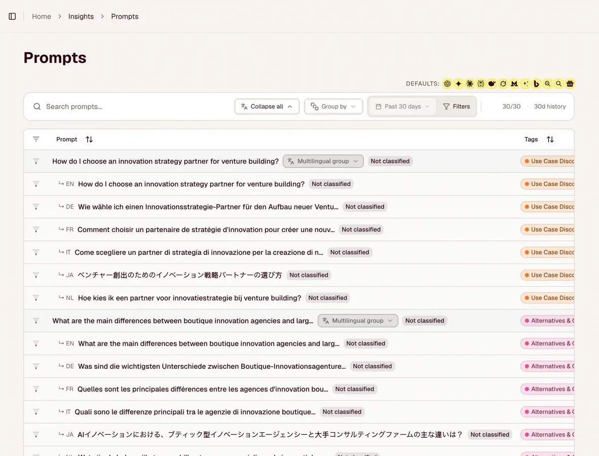

Prompts lists the questions Surfaced sends to the AI engines on your behalf, with your results for each one. It is the screen that turns "visibility is 47%" into "we lose the pricing question and win the integration question".

## Watch: see every AI answer about your brand

A four-minute walkthrough of this screen on a real workspace: the questions Surfaced asks, adding your own, reading the real answers and seeing who gets named instead.

<Frame>
  <iframe className="w-full aspect-video rounded-xl" src="https://www.youtube.com/embed/mdj-iL21ruo" title="What Does ChatGPT Say About Your Brand? How to See Every AI Answer (2026)" frameBorder="0" allow="accelerometer; autoplay; clipboard-write; encrypted-media; gyroscope; picture-in-picture" allowFullScreen></iframe>
</Frame>

<Frame>
  
</Frame>

## What is on the page

One row per prompt **per language**. A question tracked in six languages is six rows, each with its own numbers, grouped under a parent you can expand.

| Column | What it means |
| --- | --- |
| Funnel icon | The stage and decision intent you assigned the prompt. |
| Prompt | The question as sent. |
| Tags | Your own labels, used for filtering and grouping. |
| Language | The language of this row. |
| Asked from | The country the question is asked from, which changes how engines route and answer it. |
| Brand visibility | How often you were named across the answers to this prompt. |
| Share of voice | Your mentions against every brand mentioned alongside you here. |
| Mentioned by | The engines that mentioned you at least once. |
| Average position | Where you were ranked; lower is better. |
| Executions | How many times the prompt ran in the period. |
| Last update | When it last ran. |

Clicking a row opens the detail panel for that prompt. From top to bottom it shows:

- **The five KPIs** for this one question (brand visibility, citation rate, share of voice, average position, sentiment) and their trends.
- **Brand visibility per AI platform**, so you can see which engine names you and which never does.
- **Competitor Landscape**: every brand the answers named, ranked, with your own row marked.
- **What the engines searched**: the search rewrite and the follow-up searches the engines ran before answering, plus People also ask and related searches. These are the keywords worth ranking for; [What the AI searched for](https://www.youtube.com/watch?v=8H7wRxQf0r0&amp;t=170s) shows how to read them.
- **LLM Responses**: every answer word for word, with your brand highlighted and each answer marked mentioned or not mentioned.

Reading three or four answers teaches you more about a bad number than any chart.

## Controls

Search, sorting on every column, and **group by**: funnel stage, tags, language, asked-from country, brand visibility band, or branded/unbranded. Grouping by brand visibility is the fastest way to see your worst questions together.

The toolbar also shows your **response budget** rather than a prompt limit: how many tracked responses this prompt set will use against what is left this month. It warns as you approach the limit and never blocks you from adding. There is no cap on how many prompts you may save, since what costs is running them. See [Billing and usage](/account/billing-and-usage).

## Adding prompts

Three ways, all from the **Add Prompt** button and its menu:

- **Quick Add (single line).** One line in the table, defaults applied.
- **Add Manually.** The full sheet. It always creates a group: the question in your workspace's primary language, plus any language-and-country variants you add, with auto-translation you can edit or re-run.
- **Suggest a prompt.** Surfaced proposes a handful of questions based on your brand and site. Nothing is saved until you accept one.

If the workspace has no prompts at all, the empty state generates a set for you to choose from. Generated prompts appear in the table **inactive**: nothing is tracked, and nothing costs you a response, until you activate the ones you want.

## Grouping variants

Select two or more rows and choose **Group as variants** to bind differently-worded versions of the same question together, picking one as the source. They then report as one parent with expandable children, which stops a question being counted as several.

## What to watch out for

**This table is not filtered by brand scope.** It lists every prompt and badges the branded ones, while the [Analytics](/insights/analytics) KPIs default to unbranded. The two populations are different on purpose, and that is the usual reason a row count here does not reconcile with a figure there.

**"Mentioned by" hides absence.** It lists the engines that mentioned you. An engine that ran the prompt and never named you is not in the column at all, so it cannot show you where you are losing. The per-platform charts on [Analytics](/insights/analytics) can.

**Deleting a prompt deletes its history, permanently.** Every answer recorded for it goes with it, and there is no undo. If a question has stopped mattering but its past is worth keeping, untrack it instead.

**Untracking is not deleting.** Removing one language of a group keeps the row and its history and moves it to an **Untracked prompts** section with a "Track again" button. That is the safe way to stop paying for a question without losing what it told you.

**The limit stops runs, not prompts.** When the workspace reaches its monthly tracked-response allowance, the whole nightly run is skipped rather than individual prompts being paused. Nothing is deleted, and tracking resumes when the allowance resets at the start of the month or you upgrade. See [Billing and usage](/account/billing-and-usage).
